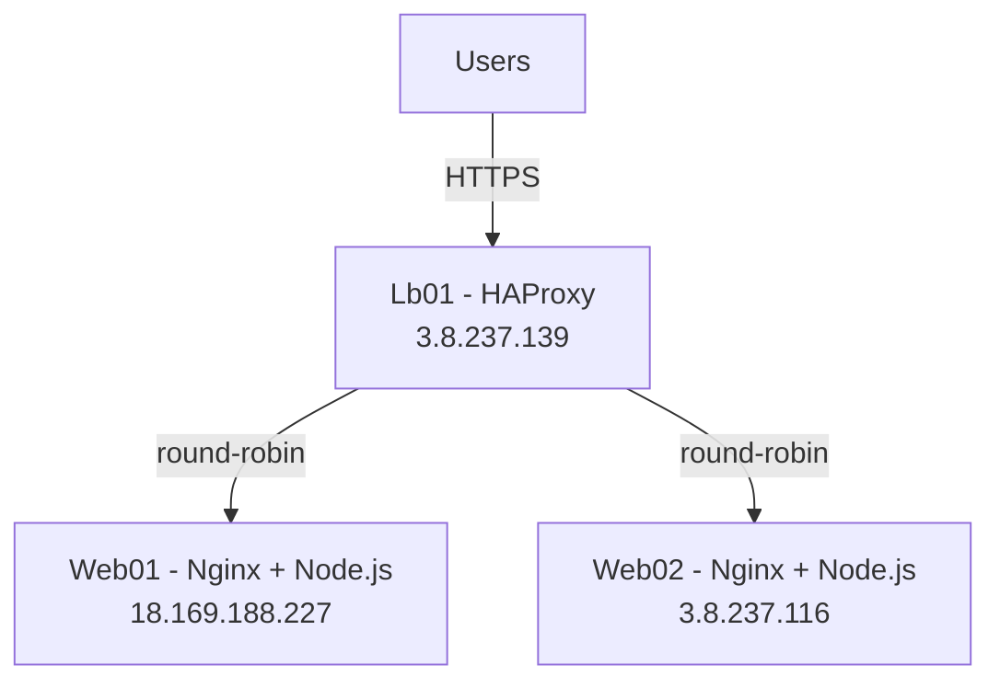

# Imvura 🌧️

**Imvura** (Kinyarwanda for "rain") is a 7-day rain and planting planner for every district in Rwanda. It turns weather forecasts into simple advice for smallholder farmers: the best days to **plant**, **spray** and **dry their harvest**.

**Live app:** https://www.testimonyikenweschool.tech/

**Demo video:** https://youtu.be/Mnuw8uHxor8

---

## Why I built this

Before studying software engineering, I built an AgTech education venture, and one thing stayed with me: smallholder farmers in Rwanda plan almost everything around rain. Planting too early or too late, spraying right before a storm, or drying a harvest on a wet day can cost a family a season's income. Weather forecasts exist, but they come as numbers, not decisions. I built Imvura to turn a 7-day forecast into plain advice for every district: when it is a good day to plant, to spray, and to dry the harvest.

---

## Features

- **Live 7-day forecast for all 30 districts**, fetched in a single API request
- **Search** districts by name
- **Filter** by province, or show only districts with heavy rain (50 mm+ this week)
- **Sort** by most rain, least rain, hottest, or name
- **Crop advice** for beans, maize and potatoes: good days to plant, spray and dry
- **Rain bars** that show at a glance how wet each district will be
- **Error handling**: clear messages if the weather service is down, the server is unreachable, a search finds nothing, or an unknown crop is requested
- **Caching**: forecasts are stored for 30 minutes, so the app is fast and fair to the free API
- **Accessible**: labelled controls, visible focus styles, a live status region for screen readers, and animations switched off for users who prefer reduced motion
- **Secure rendering**: all data is inserted with `textContent`, never raw HTML, which protects against XSS

---

## Tech stack

| Layer | Technology |
|---|---|
| Backend | Node.js, Express |
|Frontend |HTML, CSS, vanilla JavaScript |
|External API | Open-Meteo Forecast API |
|Process manager | PM2 |
|Web server | Nginx (reverse proxy) |
|Load balancer | HAProxy (round-robin, HTTPS, health checks) |

---

## Project structure

```
imvura/
├── data/districts.json         # 30 districts with province and coordinates
├── services/
│   ├── weather.js              # Calls Open-Meteo for all districts
│   ├── cache.js                # 30-minute in-memory cache
│   └── advice.js               # Plant / spray / dry rules per crop
├── public/
│   ├── index.html              # Page layout
│   ├── style.css               # Styling and animation
│   └── app.js                  # Search, filter, sort and rendering
├── deploy/
│   ├── nginx-imvura.conf       # Nginx config used on Web01 and Web02
│   └── haproxy.cfg             # HAProxy config used on Lb01
├── server.js                   # Express server and API routes
├── .env.example                # Example environment settings
└── package.json
```

---

## Run it locally

**Requirements:** Node.js 20 or newer, and Git.

```bash
git clone https://github.com/tikenwe/imvura.git
cd imvura
npm install
cp .env.example .env
npm start
```
Then open **http://localhost:3000**.

### Environment variables

| Variable | Default | Meaning |
|---|---|---|
| `PORT` | `3000` | Port the server listens on |
| `CACHE_MINUTES` | `30` | How long forecasts are cached |

No API key is needed, because Open-Meteo is free for non-commercial use.

### API routes

| Route | Description |
|---|---|
| `GET /api/health` | Returns `{"status":"ok","server":"<hostname>"}` (used by the load balancer) |
| `GET /api/forecast` | 7-day forecast for all districts |
| `GET /api/forecast?crop=maize` | The same, plus crop advice (`beans`, `maize` or `potatoes`). Any other value returns `400` with a clear message. |

---

## Deployment

The app runs on two web servers behind a load balancer:



### 1. Web01 and Web02 (the same steps on both)

**Install Git and Node.js 20:**

```bash
sudo apt-get update
sudo apt-get install -y git
curl -fsSL https://deb.nodesource.com/setup_20.x | sudo -E bash -
sudo apt-get install -y nodejs
```

**Download and set up the app:**

```bash
git clone https://github.com/tikenwe/imvura.git
cd imvura
npm install --omit=dev
cp .env.example .env
```

**Keep it running with PM2** (it restarts automatically after crashes and reboots):

```bash
sudo npm install -g pm2
pm2 start server.js --name imvura
pm2 save
pm2 startup    # then run the "sudo env PATH=..." command it prints
```
**Configure Nginx as a reverse proxy** (port 80 → port 3000). I backed up the old config, then replaced `/etc/nginx/sites-available/default` with [`deploy/nginx-imvura.conf`](deploy/nginx-imvura.conf):

```bash
sudo cp /etc/nginx/sites-available/default ~/nginx-default.backup
# write the new config (see deploy/nginx-imvura.conf)
sudo nginx -t
sudo systemctl reload nginx
```
**Check it:**


```bash
curl http://localhost/api/health
# {"status":"ok","server":"7290-web-01"}
```
### 2. Lb01 (load balancer)

HAProxy was already installed on Lb01 with HTTPS for `www.testimonyikenweschool.tech`, from an earlier project. Its backend pointed at both web servers using round-robin. For this project I added a **health check** on the app's own `/api/health` route, so HAProxy stops sending traffic to a server if Imvura stops responding:

```bash
sudo cp /etc/haproxy/haproxy.cfg ~/haproxy.cfg.backup
sudo sed -i '/balance roundrobin/a\    option httpchk GET /api/health' /etc/haproxy/haproxy.cfg
sudo haproxy -c -f /etc/haproxy/haproxy.cfg
sudo systemctl reload haproxy
```
The full config is in [`deploy/haproxy.cfg`](deploy/haproxy.cfg). Its key parts:

- Port **80** redirects to **HTTPS** (port 443)
- `balance roundrobin` takes turns between Web01 and Web02
- `option httpchk GET /api/health` checks that each server's app is healthy


### 3. Testing the load balancer

Every response includes an `X-Served-By` header, and `/api/health` returns the server's name. Calling it several times shows traffic alternating:

```bash
for i in 1 2 3 4; do curl -s https://www.testimonyikenweschool.tech/api/health; echo; done
```

```
{"status":"ok","server":"7290-web-01"}
{"status":"ok","server":"7290-web-02"}
{"status":"ok","server":"7290-web-01"}
{"status":"ok","server":"7290-web-02"}
```

---

## Challenges and how I solved them

1. **SSH access was refused** (`Permission denied (publickey)`). My SSH key was saved on my intranet profile, but all three servers rejected it, even after a soft reboot. Running `ssh -v` showed my laptop was offering the right key, so the problem was on the server side. I solved it by connecting from the ALU intranet sandbox, which uses its own `school` key: `ssh -i /root/.ssh/school ubuntu@<server-ip>`.

2. **`EADDRINUSE` when starting the server.** Port 3000 was still being used by an old copy of my server that I had left running. I found and stopped it with `lsof -ti:3000 | xargs kill`, then started the server again. I learned to always stop the old server before starting a new one.

3. **The server crashed with a `SyntaxError` in `advice.js`.** While editing, I had accidentally deleted the variable name on line 1, leaving `const {` instead of `const CROPS = {`. The error pointed at line 2, but the real mistake was the line above. I confirmed what was actually in the file with `head -3 services/advice.js`, fixed the line, and saved before restarting.

4. **A "Could not reach the server" message.** The frontend showed this whenever a network-type error happened. That time the server really was down (because of challenge 3), but I realised the same message could also hide a bug in my own code. I learned to check the terminal and the browser console (Cmd + Option + J) to find the real error, instead of trusting the on-screen message alone.

5. **"Spray: none" and "Dry: none" for every district.** At first this looked like a bug. When I checked the raw data from Open-Meteo, every district had rain on all 7 days, because November is in Rwanda's short rainy season. The app was correct: farmers should not spray or dry crops this week.

---

## What I learned

This project showed me that writing code is only half the work. I learned how a reverse proxy (Nginx) connects a public port to an app running on another port, how PM2 keeps an app alive through crashes and reboots, and how a load balancer shares traffic between servers and uses health checks to avoid sending users to a broken one. I also learned to read error messages carefully, because the line an error points to is not always where the mistake is.

---

## Credits and attribution

- **Weather data:** [Open-Meteo.com](https://open-meteo.com/), via the [Forecast API](https://open-meteo.com/en/docs). Data licensed under [CC BY 4.0](https://creativecommons.org/licenses/by/4.0/). Thank you to the Open-Meteo team for a free, open weather API.
- **[Express](https://expressjs.com/)**: web framework
- **[dotenv](https://github.com/motdotla/dotenv)**: loads environment variables
- **[PM2](https://pm2.keymetrics.io/)**: process manager
- **[Nginx](https://nginx.org/)** and **[HAProxy](https://www.haproxy.org/)**: web server and load balancer
- **[NodeSource](https://github.com/nodesource/distributions)**: Node.js packages for Ubuntu

## Notes and limitations

- District coordinates are **approximate district centres**. That's precise enough for forecast models, but not exact locations.
- Crop advice uses **simple rain rules of thumb** chosen for this project. It is **not professional agricultural advice**.

## Author

**Testimony Ikenwe**, Software Engineering student at the African Leadership University
GitHub: [@tikenwe](https://github.com/tikenwe)


